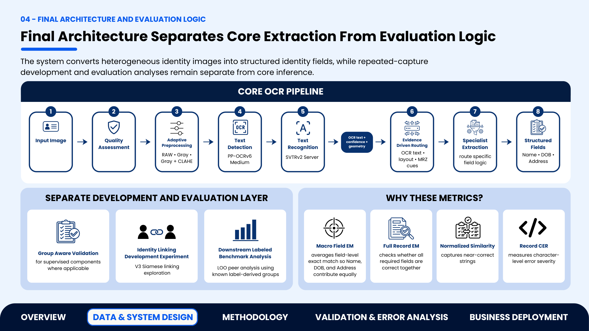

# Robust Identity Card OCR

Identity-document OCR research for structured **Name, Date of Birth, and Address** extraction from heterogeneous identity cards, passports, and driving licences.

Developed for the **COMPFEST 18 Data Science Academy final project** by **Ketolak Pacil**: Orie Abyan Maulana, Aditya Akbar, and Khansa Firyal. This repository contains only the final project, including the extracted V3–V28 development scripts. Study Case Camp 1 and Camp 2 are outside its scope.



## Approach

Quality assessment → adaptive Raw/Gray/CLAHE preprocessing → PP-OCRv6 Medium text detection → OpenOCR SVTRv2 Server recognition → evidence-driven document routing → specialist field extraction.

Development experiments additionally investigate visual identity linking, group-aware validation, and leave-one-out peer consensus. These analyses are distinguished from single-document inference in the final report.

## Reported results

The retained V28 benchmark evaluates **632 labelled images**:

| Metric | Result |
| --- | ---: |
| Name Exact Match | 46.20% |
| Date of Birth Exact Match | 70.41% |
| Address Exact Match, all rows | 83.70% |
| Macro Field Exact Match | 66.77% |
| Full Record Exact Match | 37.66% |
| Normalized Edit Similarity | 81.28% |

The all-row Address score includes blank-address labels. V27 reported 25.0% Address Exact Match on the 112 address-present rows. The unknown-layout route remains a major bottleneck. These are frozen labelled-benchmark results, not measured production performance or a newly rerun raw-image benchmark.

## Repository structure

```text
notebooks/              Final submission, pipeline-driven EDA, OCR ablation
experiments/            Portable core and development scripts V3 through V28
scripts/                Reproduction entry points and private-data setup
reports/                Technical reports and aggregate V27/V28 metrics
docs/                   Architecture, setup notes, source mapping
archive/phase_entrypoints/ Historical phase dispatchers
private/                Local original data, outputs, and submissions (ignored)
```

Duplicate scripts from the two nested archives are consolidated; the V27/V28 portable-bundle copy takes precedence. See [source mapping](docs/source_mapping.json). Cache files, notebook checkpoints, nested ZIP files, embedded identity tables, and notebook cell outputs are excluded from version control. Original final-project material is retained locally under `private/`.

## Installation and reproduction

Use **Python 3.10 or 3.11** for the pinned portable environment:

```powershell
python -m venv .venv
.\.venv\Scripts\Activate.ps1
pip install -r requirements.txt
python scripts/prepare_private_workspace.py
python scripts/run_v27.py
python scripts/run_v28.py
```

Authorized frozen evidence is required; see [data setup](docs/data_setup.md). `run_v27.py` verifies its regenerated output against the retained V27 reference. An existing generated run can be replaced with `python scripts/run_v27.py --force`.

The portable compatibility core reproduces downstream stages from frozen tables. It does **not** include the original full raw-image OCR engine, detector/recognizer weights, or all historical GPU environments. V3–V23 scripts and the historical phase dispatchers are preserved as research sources; they need the original full development environment to execute. No training or inference completeness beyond the supplied bundle is claimed.

For notebook analysis, install `requirements-notebooks.txt` and open `notebooks/01_final_submission.ipynb`. The two supporting notebooks retain their original Kaggle-oriented setup and input-discovery logic.

## Further reading

- [Final V27 report](reports/final_v27_report.md)
- [V28 Generic-ID experiment](reports/v28_generic_id_experiment.md)
- [Experiment version guide](experiments/README.md)
- [Architecture PDF](docs/architecture.pdf)
- [Repository validation record](reports/repository_validation.json)

## Repository validation

The reorganized portable V27 pipeline passed its retained-reference verification on 632 labelled records. V28 reproduced the retained aggregate metrics exactly on the local Python 3.13 runtime; one predicted Name string differs from the supplied frozen snapshot, while its recorded exact-match, CER, and similarity scores remain unchanged. The original V28 source is preserved without algorithm changes. Use the pinned Python 3.10/3.11 environment for the documented reproduction setup. All 51 Python sources parse successfully, and the three public notebooks contain no cell outputs or embedded identity-data ZIP payload.
