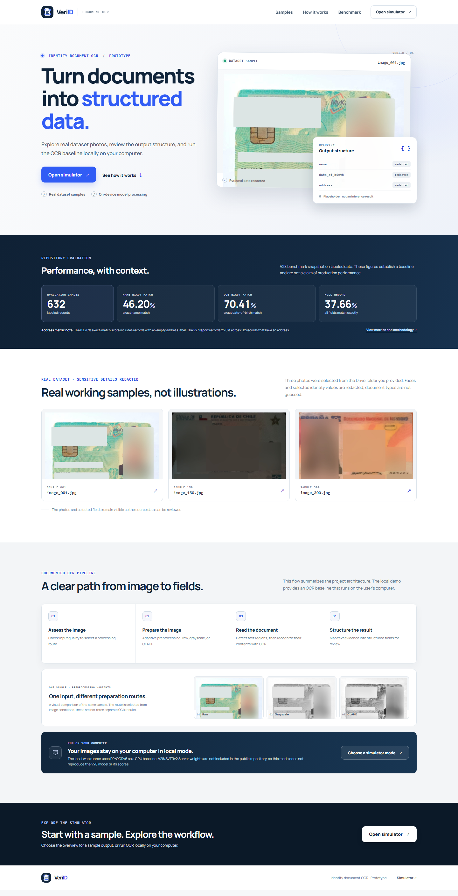

# VeriID — Identity Document OCR

VeriID is a deployable static website for exploring redacted identity-document samples and a local OCR baseline. The overview simulator shows a placeholder result; OCR inference is available only through the local runner on the user's computer.

## Deploy the static website

The site lives at the repository root and requires no build step or Node.js dependencies. To preview it locally:

~~~powershell
python -m http.server 8000
~~~

Open http://localhost:8000. The landing page and overview simulator can be published with GitHub Pages using the main branch and repository root, or hosted on another static host. Local OCR is available only when the app is served by the local runner on the same computer.

## Run OCR locally

The local runner requires Windows and Python 3.10–3.12. Install its CPU dependencies:

~~~powershell
.\local_runner\setup-local.ps1
~~~

Model weights are not included or downloaded automatically. Download a compatible PaddleOCR detector and recognizer pair and place them on your computer:

- models/PP-OCRv6_small_det/
- models/PP-OCRv6_small_rec/

See [models/README.md](models/README.md) for model paths and profile options. Start the runner, which binds only to the loopback interface:

~~~powershell
.\local_runner\start-local.ps1
~~~

Open http://127.0.0.1:8787, choose **Run locally**, and upload an image. The image is sent only to the loopback API on that computer. The public website does not receive OCR uploads. The model is loaded on the first OCR request.

## Architecture

The public site provides the landing page and a sample-only overview. The local runner serves the same app on the user's computer and exposes the OCR API there. The diagram shows the local inference and data boundary.

~~~mermaid
flowchart TD
    Visitor["Visitor"] --> PublicSite["Public static host Landing page and simulator"]
    PublicSite --> Overview["Overview mode Redacted sample assets + placeholder JSON"]
    Overview --> Placeholder["Placeholder JSON only No OCR inference"]

    Visitor --> LocalSite["Local VeriID app 127.0.0.1:8787"]
    LocalSite --> Browser["Browser on the user's computer"]
    Browser -->|"POST /api/ocr after the user starts OCR"| API["FastAPI local runner Loopback only"]
    Browser -->|"GET /api/health"| API

    API --> Validate["Validate file type, size, and image dimensions"]
    Validate --> Assess["Assess image quality"]
    Assess --> Route{"Preprocessing route"}
    Route -->|"Normal color"| Raw["Keep RGB image"]
    Route -->|"Low color variation"| Gray["Convert to grayscale"]
    Route -->|"Low contrast or extreme brightness"| CLAHE["Grayscale + CLAHE"]
    Raw --> OCR["PP-OCRv6 detector and recognizer CPU inference"]
    Gray --> OCR
    CLAHE --> OCR
    Weights[("Local detector and recognizer weights not tracked by Git")] --> OCR
    OCR --> Extract["Extract explicitly labeled fields and retain recognized text"]
    Extract --> Result["Structured JSON result"]
    Result -->|"Loopback response"| Browser

    classDef public fill:#eef3ff,stroke:#5374bd,color:#17233a
    classDef local fill:#edf8f3,stroke:#3d8568,color:#172b22
    classDef data fill:#fff7e8,stroke:#b7812b,color:#382b17
    class PublicSite,Overview,Placeholder public
    class LocalSite,Browser,API,Validate,Assess,Route,Raw,Gray,CLAHE,OCR,Extract,Result local
    class Weights data
~~~

## Method and limitations

The research architecture in [docs/assets/ocr_architecture.png](docs/assets/ocr_architecture.png) records PP-OCRv6 Medium and OpenOCR SVTRv2 Server. The public repository does not include the complete OCR engine or V28 model weights. The local runner therefore uses PP-OCRv6 small as a CPU baseline; it does not reproduce V28 or claim production-level performance.

The overview simulator displays placeholder fields, not inference results. Its three sample images come from the supplied Drive folder. Faces and selected identity values are redacted; raw source files and personal ground truth are not included.

## Repository benchmark

The V28 snapshot evaluated 632 labeled images:

| Metric | Result |
| --- | ---: |
| Name exact match | 46.20% |
| Date of birth exact match | 70.41% |
| Full-record exact match | 37.66% |

The 83.70% address score includes records with an empty address label. The V27 report records 25.0% across the 112 records that have an address. These are repository benchmark results, not production measurements. See the [V28 metrics](reports/metrics/v28.json) and [V27 report](reports/final_v27_report.md).

## Repository layout

~~~text
index.html, simulasi.html       Static website and simulator
assets/                         Logo, redacted samples, preprocessing previews
local_runner/                   Windows-only local OCR API
models/                         Local model paths; model files are Git-ignored
screenshots/                    Landing page screenshot
docs/                           Research architecture diagram
reports/                        Final report and aggregate metrics
archived/                       V3–V28 experiments, notebooks, scripts, and research notes
~~~

The contents of archived/ are retained for provenance. They are not required to serve the website or run the local OCR baseline.
